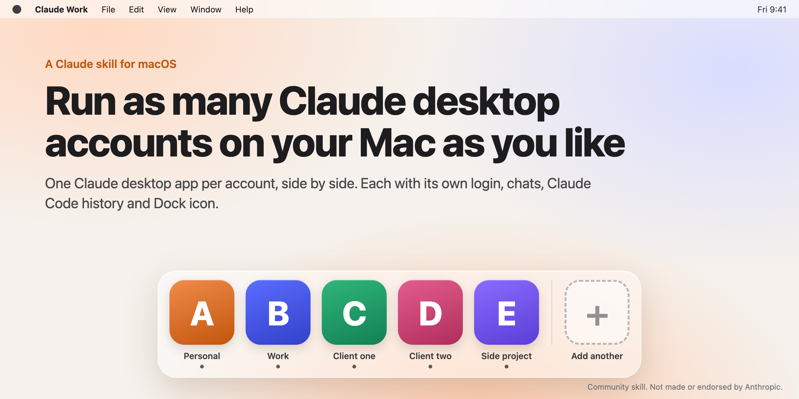

# Claude desktop multiple accounts on Mac



Run **as many Claude desktop apps on macOS as you like, one per account**, side by side: personal, work, each client. Every instance gets its own login, chats, MCP servers, Claude Code history and its own Dock icon, so you stop signing out and back in to switch accounts.

It is a Claude skill: you ask Claude Code for "a separate Claude for my work account" and it sets the instance up for you. Repeat it for a third account, a fourth, or as many as you need.

Community skill. Not made or endorsed by Anthropic.

## Platform

macOS only. I built it for my own Mac and tested it there; the scripts use macOS tools (APFS clones, Finder icons, `codesign`, LaunchServices) and only work on macOS. Windows and Linux are untested and unsupported.

## What it does

- Builds a launcher for each account (for example "Claude Work" or "Claude Acme") that starts a separate instance with its own profile folder and its own Claude Code config folder (`CLAUDE_CONFIG_DIR`).
- Gives every instance a distinct Dock icon made from your company or project logo, without modifying `Claude.app`. Its signature, Keychain access and auto-updates keep working.
- Shares your main Claude Code setup with each new instance: skills, rules and hooks are symlinked to `~/.claude`; settings and MCP servers (Claude Code and desktop) are merged in and re-synced every time the launcher starts it; plugins start as an instant APFS copy. Logins, chats, history and memory stay separate. Pass `--no-link` for a fully independent instance, or `--link` to link one you already have.
- New instances start with Claude's own default settings; the skill does not change any of them for you.
- Optionally copies Claude Code history and memory for chosen folders into another account, and explains how to move Chat Projects.
- Every script previews its changes first and only applies them with `--yes`. Claude asks you before running anything that changes your Mac.

## Install

This skill sets things up on your Mac, so it runs in **Claude Code**: the Code tab in Claude desktop, the `claude` CLI, or the Claude extension in Cursor or VS Code. It won't work from a regular chat on claude.ai or in Claude desktop's Chat tab, because those run skills in a cloud sandbox, not on your Mac.

**One command (recommended):**

```bash
npx skills add meSingh/claude-desktop-multiple-accounts -g -a claude-code -y
```

Needs Node.js. Update later with `npx skills update`.

**Or as a Claude Code plugin** (type these in Claude Code; you get updates through `/plugin`):

```
/plugin marketplace add meSingh/claude-desktop-multiple-accounts
/plugin install claude-desktop-multiple-accounts@mesingh-skills
```

## Use

Start a new Claude Code session and ask something like:

> I want a separate Claude desktop for my work account, with our company logo as the icon.

Claude walks you through it: name, logo, icon preview, setup, first sign-in and checks. Ask again for the next account.

## Requirements

- macOS 13 or later, with Claude desktop installed in `/Applications`
- Python 3 with Pillow for the custom icon (`python3 -m pip install --user pillow`); optional

## Remove an instance

Ask Claude to remove it, or run the script from the skill folder:

```bash
bash skills/claude-desktop-multiple-accounts/scripts/setup_instance.sh --name "Claude Acme" --uninstall          # preview
bash skills/claude-desktop-multiple-accounts/scripts/setup_instance.sh --name "Claude Acme" --uninstall --yes    # remove launcher and app copy, keep data
```

Add `--purge` to also delete that instance's login and Claude Code history.

## Uninstall the skill

`npx skills remove claude-desktop-multiple-accounts -g`, or `/plugin uninstall claude-desktop-multiple-accounts@mesingh-skills`.

## License

MIT
